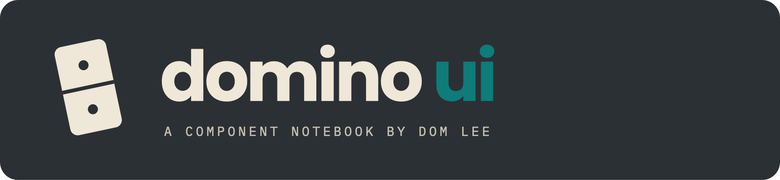
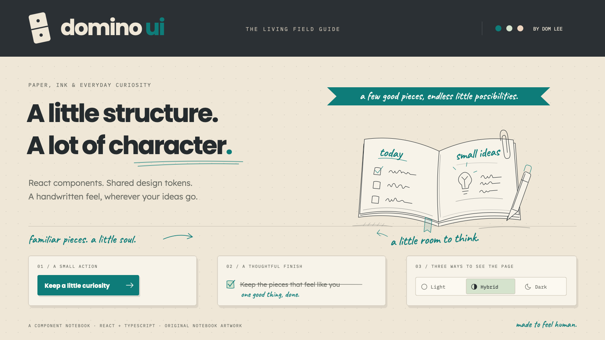
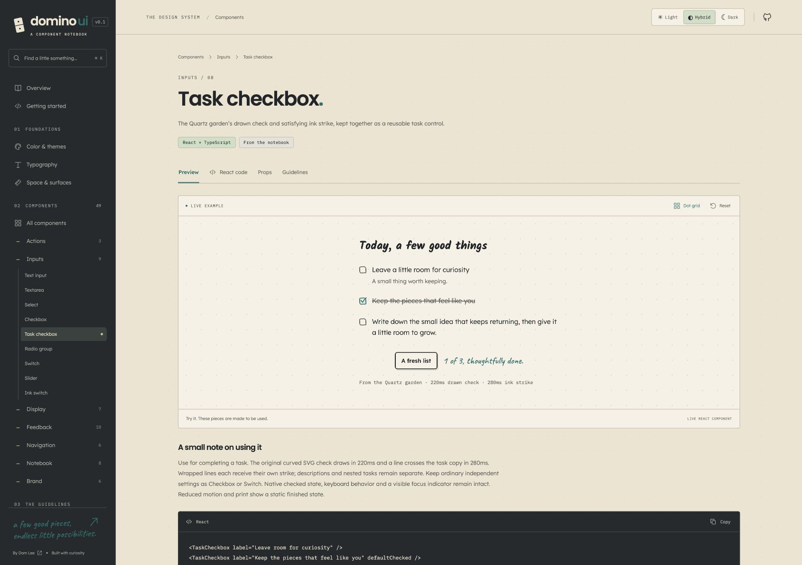
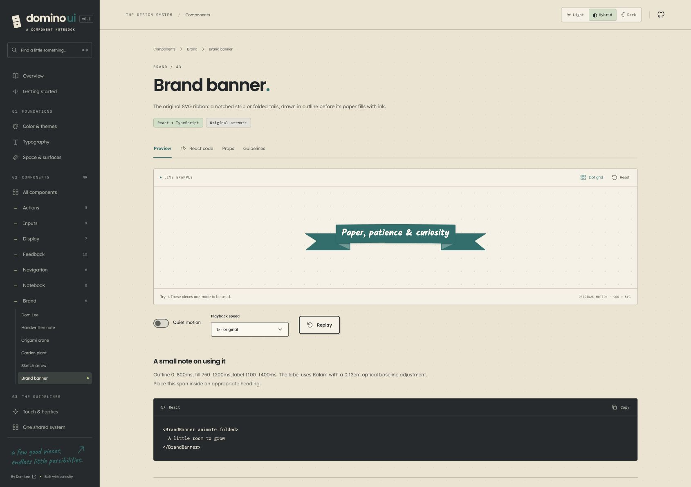
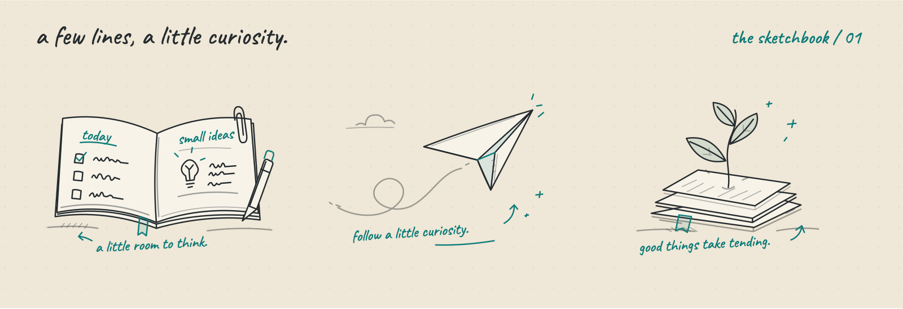
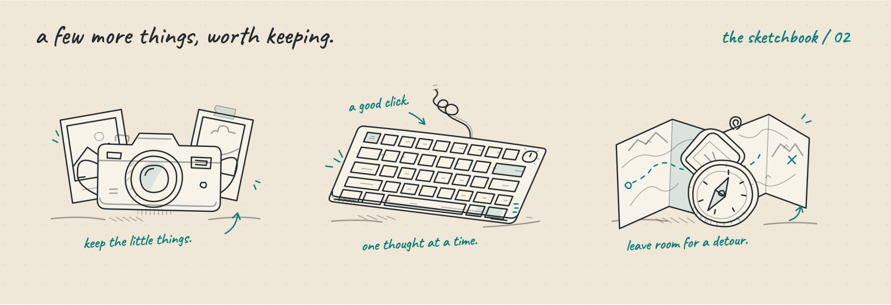

<p align="center">
  
</p>

<p align="center">
  <strong>Paper, ink, and a little curiosity.</strong><br />
  A React component library, shared design system, and living notebook by Dom Lee.
</p>

<p align="center">
  <a href="docs/ADOPTION.md">Start building</a> ·
  <a href="docs/AGENT-PROMPT.md">Agent handoff</a> ·
  <a href="DESIGN.md">Design language</a> ·
  <a href="docs/COMPONENTS.md">Components</a>
</p>

<p align="center">
  <a href="https://github.com/domogami/Domino-UI/actions/workflows/ci.yml"></a>
  
  
  
</p>



Domino UI brings the visual language of [dominicklee.net](https://dominicklee.net/) and [the Quartz garden](https://domogami.github.io/) into one reusable system: **56 documented React components**, semantic tokens, original SVG artwork, and native CSS adapters. The visual notebook puts working examples, React code, props, and usage guidance beside each component.

**Hybrid comes first:** charcoal navigation around warm paper, with teal `#0e7c79` accents. Light and Dark share the same structure, typography, and interaction rules.

## A few good pieces

| Layer                  | What is included                                                                                                           |
| ---------------------- | -------------------------------------------------------------------------------------------------------------------------- |
| **Useful controls**    | Buttons, inputs, selects, checkboxes, switches, sliders, menus, tabs, dialogs, drawers, and feedback states                |
| **Paper layers**       | Anchored popovers, single-sheet notification cards, unfolding modal decisions, edge drawers, and actionable status notes                  |
| **Notebook patterns**  | Paper cards, sticky notes, callouts, wrapping triple ribbons, bookmark drawings, annotations, and keepsake photos             |
| **Original identity**  | The **Dom Lee.** name animation, crane, plant, sketch arrows, six notebook scenes, and handwritten loading marks           |
| **Deliberate motion**  | Morphing hamburger/X, spring switches, the garden's drawn check and text strike, and per-drawing click/tap/keyboard replay |
| **Shared foundations** | Three themes, five typography roles, a 32px dot grid, spacing and motion tokens, and generated platform adapters           |
| **Touch feedback**     | Optional semantic haptics, saved preference, Safari native-switch enhancement, and documented device limits                |

Motion always has a finished resting state. Quiet and reduced-motion modes keep the interface readable and still. The shared centered SVG `Chevron` replaces font-dependent carets across disclosure controls.

## Bring it into a React project

Use **Node 24** to build from Git. React and React DOM **18+** are peers. The package is distributed from this GitHub repository; it is not published to the npm registry.

```sh
# In your application; main is convenient for an initial evaluation.
npm install git+https://github.com/domogami/Domino-UI.git#main
```

For a maintained application, replace `main` with a reviewed **full commit SHA** and keep the dependency lockfile. Git installation builds the ESM library, declarations, fonts, and native adapters through `prepare`.

Load the component and font styles once in your application's supported entry:

```tsx
import { useState } from "react";
import {
  Button,
  Card,
  NotebookSketch,
  TaskCheckbox,
  ThemeProvider,
  ThemeToggle,
} from "@domlee/ui";
import "@domlee/ui/styles.css";
import "@domlee/ui/fonts.css";
import "./notebook.css";

export default function App() {
  const [ideas, setIdeas] = useState(0);

  return (
    <ThemeProvider defaultTheme="hybrid">
      <div className="notebook">
        <header className="notebook-header">
          <strong>A few good pieces</strong>
          <ThemeToggle />
        </header>
        <main>
          <Card title="Make room for a small idea">
            <NotebookSketch
              variant="garden"
              replayOnClick
              label="An idea taking root in notebook pages"
            />
            <TaskCheckbox label="Keep a little room for curiosity" />
            <Button onClick={() => setIdeas((value) => value + 1)}>
              Plant an idea
            </Button>
            <p role="status">{ideas} ideas planted.</p>
          </Card>
        </main>
      </div>
    </ThemeProvider>
  );
}
```

```css
/* Layout belongs to the consuming application. */
.notebook {
  min-height: 100svh;
  background: var(--dm-paper);
  color: var(--dm-ink);
  font-family: var(--dm-font-body);
  line-height: 1.7;
}
.notebook-header {
  display: flex;
  flex-wrap: wrap;
  align-items: center;
  justify-content: space-between;
  gap: var(--dm-space-4);
  padding: var(--dm-space-6);
  background: var(--dm-sidebar);
  color: var(--dm-sidebar-ink);
}
.notebook main {
  max-width: 44rem;
  margin-inline: auto;
  padding: var(--dm-space-6);
}
```

Compatible CSS bundlers resolve and self-host the supplied fonts. For a static pipeline or native destination, copy the font and sketch assets, with their notices, using the installed helper:

```sh
npx --no-install domino-ui-assets ./public
```

The helper preserves identical files and refuses to replace different existing files unless you explicitly use `--force`. See the [adoption guide](docs/ADOPTION.md) for pinned installs, local tarballs, SSR/client boundaries, nested asset paths, and the complete starter.

## Components in the notebook

<table>
  <tr>
    <td width="50%"></td>
    <td width="50%"></td>
  </tr>
  <tr>
    <td><strong>A task, thoughtfully done.</strong><br />The garden's curved check and wrapped ink strike, backed by a native checkbox.</td>
    <td><strong>A little celebration.</strong><br />Original folded ribbon geometry with a face that grows around its text.</td>
  </tr>
</table>

```tsx
import {
  BrandBanner,
  BookmarkDrawing,
  TripleBanner,
  HandwrittenNote,
  HeroName,
  Skeleton,
  TaskCheckbox,
} from "@domlee/ui";

export function NotebookPieces() {
  return (
    <>
      <BrandBanner folded>Paper, patience & curiosity</BrandBanner>
      <TripleBanner
        lines={["A few good pieces", "room for a longer thought", "kept together"]}
        animate
        replayOnClick
      />
      <BookmarkDrawing variant="notched" replayOnClick label="A place kept for later" />
      <HandwrittenNote>a small thought in the margin</HandwrittenNote>
      <HeroName replayKey={0} />
      <TaskCheckbox label="Leave a little room to explore" />
      <div aria-busy="true" aria-label="Loading a journal entry">
        <Skeleton width="70%" height={20} />
      </div>
      <p role="status">Loading a journal entry…</p>
    </>
  );
}
```

Every catalog entry documents its real API, origin, meaningful states, and composition guidance. [Browse the component inventory](docs/COMPONENTS.md) or run the notebook below to use the live examples.

[Open the component notebook](https://ui.dominicklee.net/) · [Paper layers](https://ui.dominicklee.net/#layers) · [Motion & page flow](https://ui.dominicklee.net/#motion)

## A thought in the foreground

Popovers stay beside their trigger. Important decisions open on a clear modal surface. Notification cards collect source, message, and action on one piece of paper, with a readable queue badge, a thin accent seam, and one subtle ink edge. Dialogs arrive softly from the right as one connected note, with a shared 160ms fade during the 360ms unfolding motion. The header stays flat and moves with the paper. Closing slides the note right and coordinates its fold, tuck, and shared fade over 240ms. `motion="settle"` provides a quiet alternative; drawers and the command palette keep their 240ms/160ms settle motion. Dialogs and toasts also support short context labels and distinct actions.

The **Paper layers** notebook route (`/#layers`) brings them together in all three themes. The interaction study draws on [Pebble's design guidance](https://developer.repebble.com/guides/design-and-interaction/core-experience/): glanceable hierarchy, a few meaningful colors, visible actions, and purposeful motion. The paper surfaces, folding motion, teal accents, and handwriting remain Domino's own treatment. [Layer APIs, examples, accessibility, and provenance](docs/LAYERS.md).

## A sketchbook with room to grow




`NotebookSketch` offers **notebook, flight, garden, camera, keyboard, and compass**. Fine rounded strokes, loose curves, sparse color, and Caveat captions keep the drawings in the same notebook. Click, tap, Enter, or Space replays just that drawing while its button keeps focus.

`TripleBanner` adds three connected ribbon faces whose real labels wrap naturally; `BookmarkDrawing` offers notched and pointed hanging bookmarks. Their original reference-inspired geometry uses the same fine pen, teal seam, and quiet replay behavior. Set `animate` as well as `replayOnClick` for a replayable triple ribbon.

`HairlineSketch` adds three actual [Hairline](https://github.com/lucasmarkes/hairline) figures—**riffle, branches, and loupe**—in the shared palette. Replay draws an ink sweep; the guided pointer tour is a separate opt-in. Both treatments honor quiet and reduced motion.

Eighteen completed SVGs cover all six original scenes in Light, Hybrid, and Dark, with embedded caption fonts and OFL notices. [Sketch APIs and reusable assets](docs/SKETCHES.md).

## One system, native destinations

| Destination            | Integration                                                     | Current boundary                                                  |
| ---------------------- | --------------------------------------------------------------- | ----------------------------------------------------------------- |
| **React applications** | Typed components, CSS, fonts, tokens, and theme controls        | Packed/Git consumer installation and production builds are tested |
| **Personal website**   | React components or the portfolio CSS bridge                    | Destination adoption is planned                                   |
| **Quartz garden**      | Generated native CSS, fonts, and existing three-mode controller | Adapter is prepared; real destination acceptance remains          |
| **Obsidian**           | A switchable CSS snippet over the installed theme               | Overlay is prepared; base theme and private vault stay native     |

Shared values live in **`tokens/system.json`**. Change the canonical source, run `npm run build:system`, and adopt a reviewed revision in each consumer. Component behavior lives in `src/lib/`; platform translations live in `src/adapters/`. Applications keep their routing, content, layout, and product behavior.

[Shared architecture](docs/SHARED-SYSTEM.md) · [Quartz](docs/QUARTZ.md) · [Obsidian](docs/OBSIDIAN.md) · [Agent adoption prompt](docs/AGENT-PROMPT.md)

## Run the living notebook

```sh
git clone https://github.com/domogami/Domino-UI.git
cd Domino-UI
npm ci
npm run dev
```

Open the printed local URL, normally **http://127.0.0.1:5173/**. Use **⌘K / Ctrl+K** to find components. The guide includes color themes, typography specimens, spacing and surfaces, writing rules, paper layers (`/#layers`), haptics, shared platform previews, and replayable motion.

```sh
npm run check             # Generated token consistency + TypeScript
npm run test:system       # Theme, adapter, font, and manifest contracts
npm run test:package      # Installed consumer: types, SSR, fonts, assets, Vite
npm test                  # Component interactions and responsive behavior
npm run test:production   # Built site in mobile Chrome and WebKit
npm run build             # Static notebook → dist/
npm run build:lib         # Reusable ESM, CSS, declarations, fonts → lib/
npm run export:sketches   # Regenerate the 18 static SVG companions
```

Install browser runtimes with `npx playwright install chromium webkit` when needed. The development and production suites keep separate artifacts. Netlify publishes `main` to [ui.dominicklee.net](https://ui.dominicklee.net/) as a separate project. [Deployment, verification, and rollback](docs/DEPLOYMENT.md).

## Design notes and provenance

- [Design language](DESIGN.md): exact colors, typography, journal meanings, paper shapes, identity, and motion.
- [Accessibility](docs/ACCESSIBILITY.md): labels, keyboard behavior, focus, reduced motion, and composition responsibilities.
- [Paper layers](docs/LAYERS.md): Pebble-inspired hierarchy, notification cards, popovers, dialogs, drawers, and status feedback.
- [Page flow](docs/ROUTING.md): content-only View Transitions, progressive routing, interruption, history, focus, and reduced motion.
- [Touch & haptics](docs/HAPTICS.md): opt-in feedback, trusted gestures, Safari native switches, and physical-device acceptance.
- [Assets & attribution](docs/ASSETS.md): original artwork, public sample photos, font OFL notices, and Hairline's MIT license.

This is Dom Lee's personal design system, with no blanket open-source license granted for the original code and brand artwork. Third-party assets retain their included licenses. The package stays `private` to prevent accidental npm-registry publication; GitHub installation is supported.

Built from a personal notebook. Made to keep the pieces together.
