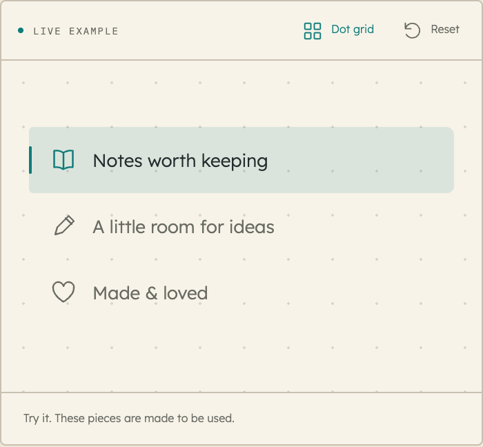

# A fluid navigation trail

The notebook sidebar uses one persistent paper highlight that travels between destinations. Its position, width, and height retarget from the current painted frame when selection changes quickly. Nested component links keep their own indentation. The treatment adapts the fluid selection behavior in the Christiane project to Domino's paper, ink, and native links.

`NavTrail` exposes the same behavior to consumers. See the [interactive example](https://ui.dominicklee.net/#component/nav-trail).



```tsx
import { useRef } from "react";
import { NavTrail } from "@domlee/ui";
import "@domlee/ui/styles.css";

function Sidebar({ route }: { route: string }) {
  const nav = useRef<HTMLElement>(null);
  return (
    <nav ref={nav} className="dm-nav-trail-host" aria-label="Notebook">
      <NavTrail containerRef={nav} activeKey={route} />
      <a href="/notes" aria-current={route === "notes" ? "page" : undefined}>
        Notes
      </a>
      <a href="/ideas" aria-current={route === "ideas" ? "page" : undefined}>
        Ideas
      </a>
    </nav>
  );
}
```

Style the original rows with comfortable padding and a transparent selected background. The default surface is a light accent wash over the containing paper. Override `--dm-nav-surface` and `--dm-nav-accent` on the host for a different surface; the notebook’s charcoal sidebar maps those to its own sidebar roles. The included host class provides the positioning and stacking context; the marker cannot receive pointer events or keyboard focus. Keep exactly one selected element inside each host. `activeSelector` defaults to `[aria-current="page"]`, `itemSelector` to `a[href],button`, and `iconSelector` to `.dm-nav-icon`. Custom selectors can target an existing application's equivalent structure.

The application owns route state, URLs, history, focus, scroll restoration, and drawer semantics. Pass a committed route or selection as `activeKey`; the marker also observes relevant content, font, and size changes. Host scrolling keeps the highlight aligned with its row. The first measured placement appears in place, without flying from the top corner. Server output is a harmless, unmeasured decorative span.

## A small gesture from the icons

Place `className="dm-nav-icon"` on an existing inline SVG. Add `data-nav-icon="pen"`, `heart`, `sparkle`, `ruler`, `type`, `play`, or `code` on its row for a corresponding finite gesture; other names get a restrained turn. The original outline traces once on pointer hover, keyboard focus, or a new selection, then rests. Icon shapes, accessible names, and native click behavior stay intact. This is optional; a text-only navigation works equally well.

`quiet` and the operating system's reduced-motion preference make selection immediate and cancel icon gestures. The canonical `nav-duration` and `nav-icon-duration` are both 420ms; `nav-easing` is `cubic-bezier(.22,.8,.24,1)`. They are separate from the 360ms drawer/hamburger motion and the page's View Transition. [Page flow](ROUTING.md) documents their coordination.
