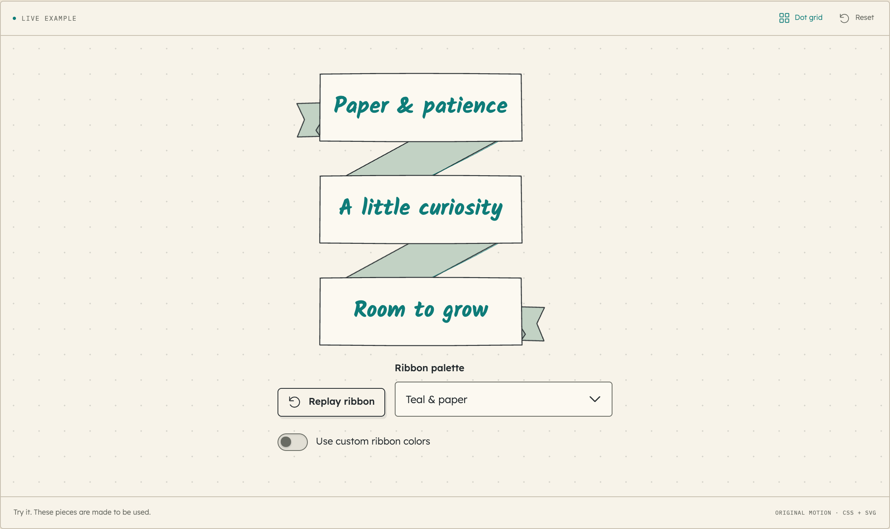

# A little ribbon ceremony

`RibbonBanner` is a reusable Notebook component with three connected faces. `TripleBanner` remains a compatible name for exactly the same component and props. The [live ribbon page](https://ui.dominicklee.net/#component/triple-banner) includes replay, four semantic palettes, and individual color controls.



```tsx
import { RibbonBanner, type RibbonBannerProps } from "@domlee/ui";
import "@domlee/ui/styles.css";

const colors: RibbonBannerProps["colors"] = {
  face: "#fbf9f1",
  reverse: "#bfd0c4",
  ink: "#0e7c79",
  outline: "#272d30",
};

<RibbonBanner
  lines={["Paper & patience", "A little curiosity", "Room to grow"]}
  colors={colors}
  animate
  replayOnClick
/>;
```

Omit `colors` to follow the current theme. `tone="accent"` is the default; `sage`, `peach`, and `ink` provide alternative semantic palettes. `colors` overrides only supplied roles and accepts CSS color values, including custom properties such as `var(--my-ribbon-face)`. Choose contrasting ink and face colors. Keep the default palette when the consuming application should follow Hybrid, Light, and Dark automatically.

All three faces share one width derived from the longest section, including a long middle or final label. The available container width caps that size; labels wrap naturally and each face grows vertically. Constrain the container with `max-width` rather than fixing a face height. Long words wrap, and browser zoom or font changes retain real text. Fine decorative strokes stay clear of the labels.

## Ink, color, then words

`animate` defaults to `false`. When enabled, the five paper parts draw in order, their faces and reverse folds fill, and the three handwritten labels reveal. The default sequence lasts about 2.12 seconds: 800ms outline, 360ms fill, 320ms label, with 80ms staging. The canonical `ribbon-outline-duration`, `ribbon-fill-duration`, `ribbon-label-duration`, and `ribbon-stagger` tokens live in `tokens/system.json`; run `npm run build:system` after changing them. The existing `speed` values `0.5`, `1`, `1.5`, or `2` scale the choreography.

With `animate replayOnClick`, a stable native button replays on tap, click, Enter, or Space. Keep replayable labels plain and noninteractive, and use a concise `label` if their combined text is not a useful accessible name. An external control can increment `replayKey` instead. Replaying resets owned animation clocks without replacing the real labels or taking keyboard focus away.

The complete label stays available to assistive technology and remains readable throughout the visual reveal. `quiet`, reduced motion, server rendering, and print show completed artwork. Quiet/reduced replay controls are disabled. Use static artwork with `animate={false}` for a heading whose entrance should not repeat when its surrounding content updates.
